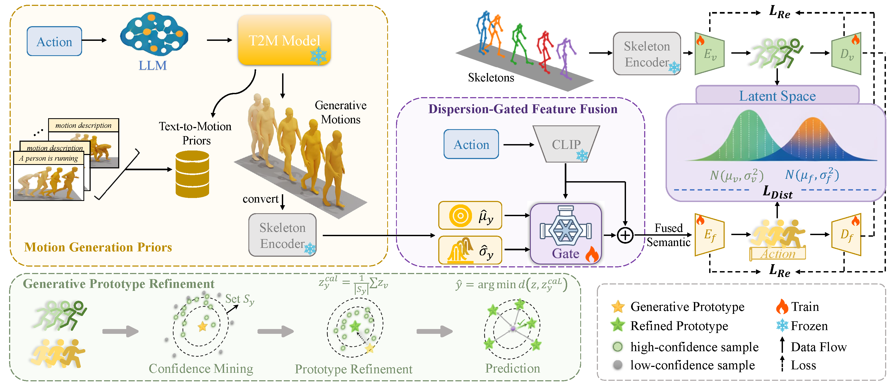

<div align="center">

<h1>GenPrior: Unleashing Text-to-Motion Generative Priors for<br>Zero-Shot Skeleton-based Action Recognition</h1>

<p>
  Jidong Kuang &nbsp;&middot;&nbsp; Hongsong Wang<sup>*</sup> &nbsp;&middot;&nbsp; Jie Gui<sup>*</sup>
  <br>
  Southeast University
  <br>
  <sup>*</sup>Corresponding authors
</p>

<p><strong>ACM Multimedia 2026 (ACM MM '26)</strong></p>

<p>
  <a href="https://jidongkuang.github.io/projects/GenPrior/" target="_blank" rel="noopener noreferrer">
    
  </a>
  <a href="https://arxiv.org/abs/2608.02236" target="_blank" rel="noopener noreferrer">
    
  </a>
  
  <a href="paper/GenPrior.pdf" target="_blank" rel="noopener noreferrer">
    
  </a>
  <a href="https://github.com/jidongkuang/GenPrior/stargazers" target="_blank" rel="noopener noreferrer">
    
  </a>
</p>

</div>

Official PyTorch implementation of **GenPrior**, the first framework to exploit
generative priors from pre-trained Text-to-Motion models for zero-shot
skeleton-based action recognition.

> **TL;DR:** GenPrior distills kinematic structure from generated motions,
> adaptively injects it into textual semantics, and refines unseen-class
> prototypes with high-confidence test samples.

---

## 📑 Table of Contents

- [💡 Overview](#-overview)
- [📊 Results](#-results)
- [🗓️ Plan](#️-plan)
- [🗂️ Repository Structure](#️-repository-structure)
- [⚙️ Installation](#️-installation)
- [📦 Data and Checkpoints](#-data-and-checkpoints)
- [🚀 Quick Start](#-quick-start)
- [🏋️ Training](#️-training)
- [📊 Evaluation](#-evaluation)
- [🙏 Acknowledgements](#-acknowledgements)
- [📝 Citation](#-citation)

## 💡 Overview

<p align="center">
  
</p>

<p align="center"><em>GenPrior extracts kinematic priors from generated motions, integrates them with textual semantics, and refines unseen-class prototypes at inference.</em></p>

## 📊 Results

Paper-reported results are summarized below. All values are percentages.

### Fixed-split ZSL

| Dataset | Split | Accuracy |
|---|---:|---:|
| NTU RGB+D 60 | 55 / 5 | 87.98 |
| NTU RGB+D 60 | 48 / 12 | 73.43 |
| NTU RGB+D 120 | 110 / 10 | 90.44 |
| NTU RGB+D 120 | 96 / 24 | 81.39 |

### Random-split ZSL

| Dataset | Protocol | Mean accuracy |
|---|---:|---:|
| NTU RGB+D 60 | 3 splits | 96.3 |
| NTU RGB+D 120 | 3 splits | 84.7 |
| PKU-MMD | 3 splits | 74.7 |

### Generalized ZSL

| Dataset | Split | Seen | Unseen | Harmonic mean |
|---|---:|---:|---:|---:|
| NTU RGB+D 60 | 55 / 5 | 73.5 | 80.0 | 76.6 |
| NTU RGB+D 60 | 48 / 12 | 65.5 | 61.4 | 63.4 |
| NTU RGB+D 120 | 110 / 10 | 67.1 | 75.2 | 70.9 |
| NTU RGB+D 120 | 96 / 24 | 56.5 | 55.4 | 55.9 |

See the [experiment guide](docs/EXPERIMENTS.md) for the exact configurations
and evaluation protocols.

## 🗓️ Plan

- [x] Paper and project page
- [x] Training and evaluation code
- [ ] Processed data
- [ ] Pretrained models

## 🗂️ Repository Structure

```text
GenPrior/
├── configs/          # Configurations for Tables 1-3
├── genprior/         # Models, data loaders, and training logic
├── scripts/          # Table experiment launchers and GZSL evaluation
├── semantics/        # Class-level semantic descriptions
├── tests/            # Configuration, data, and prediction checks
├── docs/             # Protocol and experiment details
├── paper/            # Camera-ready paper
└── train.py          # Main training entry point
```

## ⚙️ Installation

The reference environment uses Python 3.9, PyTorch 2.1.1, CUDA 11.8, and
Transformers 4.39.0.

```bash
git clone https://github.com/jidongkuang/GenPrior.git
cd GenPrior
conda env create -f environment.yml
conda activate genprior
```

Build the Shift-GCN temporal-shift CUDA extension:

```bash
cd genprior/models/shiftgcn/temporal_shift/cuda
python setup.py build_ext --inplace
cd ../../../../../
```

## 📦 Data and Checkpoints

The processed data and pretrained checkpoints will be released together in a
single **Google Drive archive (coming soon)**. Extract the archive into the
repository root with the following structure:

```text
skeleton_features/
  synse_features/
  sa_dvae_features/
data/
  generated_motions.pkl
checkpoints/
  skeleton_encoder.pt
  table1/
  table3/
```

The CLIP text encoder can be provided as either a local Transformers directory
or a compatible model identifier through `text_encoder_name_or_path`.

## 🚀 Quick Start

After placing the data and checkpoints in the paths above, evaluate all four
pretrained Table 1 checkpoints with one command:

```bash
bash scripts/evaluate_table1.sh 0 outputs/evaluation/table1
```

This command performs evaluation only and writes the result for each split to
its output directory.

## 🏋️ Training

Train one configuration:

```bash
python train.py \
  --config configs/table1/ntu60_xsub_unseen5.yaml \
  --device 0 \
  --output-dir outputs/ntu60_55_5
```

Run the experiments reported in Tables 1-3:

```bash
bash scripts/run_table1.sh 0 outputs/table1
bash scripts/run_table2.sh 0 outputs/table2
bash scripts/run_table3.sh 0 outputs/table3
```

The first argument is the CUDA device index; the second is the output root.

## 📊 Evaluation

### ZSL

Evaluate one fixed-split ZSL checkpoint:

```bash
python scripts/evaluate_zsl.py \
  --config configs/table1/ntu60_xsub_unseen5.yaml \
  --checkpoint checkpoints/table1/ntu60_55_5/best_gpr.pt \
  --device 0 \
  --output-dir outputs/evaluation/ntu60_55_5
```

### GZSL

Evaluate one generalized ZSL checkpoint:

```bash
python scripts/evaluate_gzsl.py \
  --config configs/table3/ntu60_xsub_unseen5.yaml \
  --checkpoint checkpoints/table3/ntu60_55_5/best_gzsl.pt \
  --device 0 \
  --output-dir outputs/evaluation/ntu60_55_5_gzsl
```

See the [experiment guide](docs/EXPERIMENTS.md) for the exact settings used by
each split.

## 🙏 Acknowledgements

We sincerely thank the authors of the following projects for their valuable
open-source contributions:

- <a href="https://github.com/cseeyangchen/Flora" target="_blank" rel="noopener noreferrer">Flora</a>
- <a href="https://github.com/skelemoa/synse-zsl" target="_blank" rel="noopener noreferrer">SynSE</a>
- <a href="https://github.com/Linketic/StableMoFusion" target="_blank" rel="noopener noreferrer">StableMoFusion</a>

This repository also builds upon
<a href="https://github.com/kchengiva/Shift-GCN" target="_blank" rel="noopener noreferrer">Shift-GCN</a>
and CLIP. The adapted
Shift-GCN files retain the upstream CC BY-NC 4.0 license; further third-party
attribution is provided in [NOTICE.md](NOTICE.md).

## 📝 Citation

If you find this work useful, please cite:

```bibtex
@article{kuang2026genprior,
  title={GenPrior: Unleashing Text-to-Motion Generative Priors for Zero-Shot Skeleton-based Action Recognition},
  author={Kuang, Jidong and Wang, Hongsong and Gui, Jie},
  journal={arXiv preprint arXiv:2608.02236},
  year={2026}
}
```
